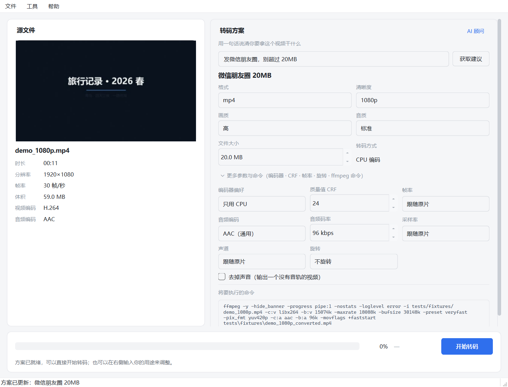
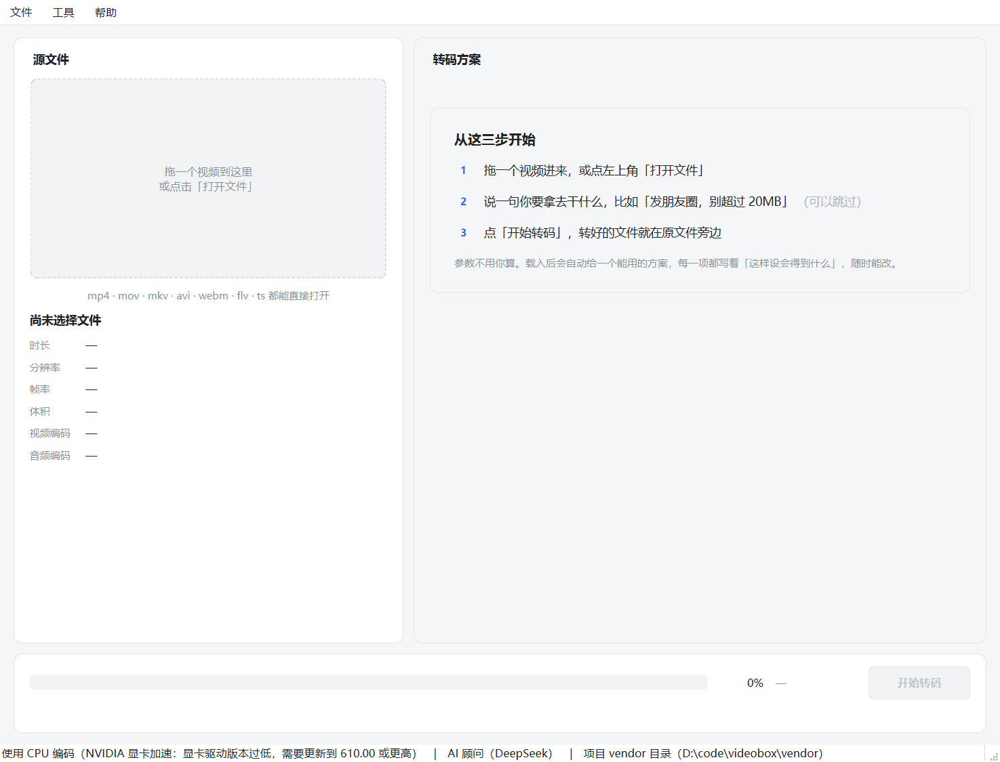

# VideoBox

**把视频拖进来，说一句人话，它把参数配好，然后转完。**

一个 Windows 桌面视频转码器。界面用 PySide6（Qt for Python），转码走 FFmpeg 命令行，
中间夹一个参数顾问：用自然语言描述你要拿这个视频干什么，它给出可编辑的参数方案，
并把"这样设会得到什么"用人话讲清楚。


**下载即用，不需要装 Python，也不需要装 FFmpeg**（已随包附带）。见[Releases](../../releases)。

---

## 目录

- [它想解决什么](#它想解决什么)
- [三步用起来](#三步用起来)
- [功能](#功能)
- [界面上的几个取舍](#界面上的几个取舍)
- [下载与运行](#下载与运行)
- [它怎么搭的](#它怎么搭的)
- [它是怎么被验证的](#它是怎么被验证的)
- [已知限制](#已知限制)
- [文档](#文档)
- [关于这个项目](#关于这个项目)

## 它想解决什么

转码这件事，门槛从来不在算力上，在于**没人愿意学。**

FFmpeg 的能力足够覆盖 95% 的日常需求，但它的入口是 `-crf 23 -maxrate 2M -bufsize 4M`
这类东西。拿"我要发个朋友圈"这个需求去对照，中间隔着一整套需要先理解才敢动的概念：
CRF 是什么、23 算好还是差、为什么还要 maxrate、bufsize 又是什么。

于是日常出现两种结局：要么去用在线转换器（要上传、有体积限制、内容过谁的服务器不知道），
要么打开一个参数面板型的桌面转换器，被同样一屏工程参数劝退。

VideoBox 的假设是：**用户知道自己要干什么，只是不知道对应的参数是什么。**
那就让他说前者，程序负责后者。

## 三步用起来

**1. 拖进来**

左栏立刻出现缩略图和这个文件的基本信息——时长、分辨率、帧率、体积、编码格式。
不需要先做任何设置。

**2. 说一句用途**（可以跳过）

> 「发微信朋友圈，别超过 20MB」
> 「这是会议录屏，只要字看得清，画质无所谓」
> 「存档用，别给我降分辨率」

方案会落到右栏，六个参数全部是可选的档位，不是需要背下来的数字。
想要 CRF、帧率、采样率这些，展开「更多参数与命令」，它们都在，还能直接看到
将要执行的那条命令。不想说话也行——载入文件时就已经给了一个通用方案，直接转就可以。

**3. 点开始，看结果**

进度条、剩余时间、取消按钮。转完给一行前后对比：原来多大、现在多大、压掉了多少、
花了几秒。


## 功能

### 用一句话换一套参数

说人话 → 结构化的转码参数。三条约束让这件事不至于跑偏：

1. **模型没有输出命令的权力**。它只能从枚举里挑值（容器、清晰度档位、编码器偏好），
   命令行由程序自己拼。这样"提示词注入"最多让方案变差，不会变成一条危险命令。
2. **提示词里注入本机实测可用的编码器**，模型不会推荐一台跑不动的硬件编码器。
3. **没有 API Key 时降级到本地规则引擎**，走同一套 schema、同一个界面，
   只是"大脑"从模型换成关键词匹配。它不是一个占位符，是真能用的功能。

### 硬件编码先去试，再决定用不用

`ffmpeg -encoders` 列出来的编码器不等于这台机器能跑——列表里有、实际启动失败的情况很常见
（驱动版本不够、显卡被别的进程占着、虚拟机里没有设备）。所以启动时会真的各跑 1 秒试编码，
跑不动就退回 CPU。

界面上只说当前用的是哪个。为什么没用上显卡，鼠标悬停状态栏就能看到——
多数人不需要知道，需要的人找得到。

### 转码过程可见、可取消

解析 `-progress` 输出，给实时进度、速度和剩余时间。取消时不是杀进程，是给 ffmpeg
写一个 `q` 让它正常收尾——**取消后的产物仍然是一个能播放的完整视频**，不是截断的坏文件。

硬件编码中途失败会自动切到 CPU 重跑一次，用户看到的是结果，不是一段红色报错。

### 手机拍的片子，能转正、能静音

竖着拍的视频在电脑上常常是歪的，录屏里的内部讨论不想留声音。
「更多参数与命令」里两下就处理完：旋转（顺时针 90° / 180° / 逆时针 90°）和「去掉声音」。

旋转改的是像素本身，不是容器里的一个方向标记——所以换任何播放器看都一致，
代价是重新编码一次（本来也在重编码）。转正放在缩放之前，否则缩放会按歪的宽高算，
尺寸会差一倍。

### 转完给你看数字

体积、压缩率、耗时、实际速度。压缩不是玄学，是一个能核对的结果。


## 界面上的几个取舍

这一节讲的是判断，不是功能。

**默认给判断，高级给参数。** 主界面只出现人能判断的东西：画质是
「极佳 / 高 / 标准 / 省体积」，音质是「省流量 / 标准 / 清晰 / 高音质」，
清晰度是「原画 / 1080p / 720p / 480p」。想要数值的人往下走一层，
「更多参数与命令」里有编码器偏好、CRF、帧率、音频编码、码率、采样率、声道、旋转——
入口文案把能改的东西列出来，而不是写一句抽象的"高级设置"。

两层不是两套配置，是同一个值的两种说法：改档位 CRF 跟着走，改 CRF 档位跳到最近的一档。
选了 25 就按 25 跑，档位只是它的快捷方式。不同步的话，用户改了 A 却发现实际跑的是 B——
那是最坏的一种 bug：他做了操作、看到了反馈、结果不是他要的。



**说明只讲结果，不讲理由。** 界面上出现的每一句话都回答"这样设会怎样"：

> ✓ 文件能压到 20 MB 以内，朋友圈直接发出去
> ⚠ 原片如果是横屏、画面里又有小字，720p 后字可能有点糊

而不是"为什么选了这个参数"。这里不会出现「置信度 85%」这类东西——
**读的人拿它做不出任何决定，那它就不该出现在界面上。**

**验证用的东西收起来，但不藏。** 高级设置最底下是完整的那条 ffmpeg 命令，默认折叠。
有人想确认这软件有没有偷偷上传、有没有偷偷改参数，展开一眼就看清楚；
多数人不需要，就不该占着屏幕。

**空状态给路径，不给控件。** 没有视频时，右栏不是六个灰掉的下拉框——那种界面看着像
"已经配好了"，其实一个都点不动。现在是一张写着三步的卡：

> ① 拖一个视频进来，或点左上角「打开文件」
> ② 说一句你要拿去干什么，比如「发朋友圈，别超过 20MB」　（可以跳过）
> ③ 点「开始转码」，转好的文件就在原文件旁边

左栏的拖拽区下面直接写清支持哪些格式——用户拖之前就想知道 `.mov`、`.mkv` 行不行。
"开始转码"在没素材时是灰的，不是亮着等你去点、点了再告诉你"请先打开视频"。



判断标准就一句：空状态里每一个可见的元素，都该回答"下一步做什么"。

## 下载与运行

### 直接跑

从 [Releases](../../releases) 下载 `VideoBox-win64.zip`，解压后双击 `VideoBox.exe`。
免安装，FFmpeg 已内置。

### 从源码跑

```bash
git clone https://github.com/ftf112233/videobox.git && cd videobox
python -m venv .venv
.venv\Scripts\activate
pip install -r requirements.txt

# 把 ffmpeg.exe / ffprobe.exe 放进 vendor\（见 docs/SETUP.md）
python main.py
```

仓库里带了一段 0.6 MB 的样片 [`docs/sample.mp4`](docs/sample.mp4)，可以直接拖进界面试，
不用先自己找素材。想用演示 GIF 里那段 11 秒 1080p 素材的话：

```bash
python scripts/make_fixtures.py
```

### 自己打包

```bash
python scripts/build.py      # 产物在 dist/VideoBox/
```

## 它怎么搭的

分层的唯一目的是**让核心逻辑能脱离界面被测试**。`core/` 里没有一行 Qt。

```
videobox/
├── core/          零依赖，纯函数，全部可单测
│   ├── models.py        VideoInfo / TranscodePlan / TranscodeResult
│   ├── probe.py         ffprobe JSON 解析 + ffmpeg -i 兜底
│   ├── thumb.py         抽帧与缓存
│   ├── params.py        plan → ffmpeg 参数列表
│   ├── progress.py      -progress 输出解析 + ETA
│   ├── plan_schema.py   模型输出的清洗与校验
│   ├── labels.py        工程参数 ↔ 用户能懂的档位
│   └── local_rules.py   无 Key 时的本地规则引擎
├── infra/         与外部世界打交道
│   ├── ffmpeg_bin.py    ffmpeg 定位降级链 + 编码器实测
│   ├── process.py       QProcess 封装（进度 / 取消 / 判定）
│   ├── llm_client.py    同步 LLM 客户端（标准库 urllib，零依赖）
│   ├── advisor.py       顾问编排：AI 与本地规则同一出口
│   └── logging_setup.py 日志落盘
└── ui/            PySide6
    ├── main_window.py   组装与状态机
    ├── tasks.py         线程池工人
    ├── style.qss        浅色主题
    └── widgets/         信息栏 / 顾问面板 / 进度面板
```

**线程模型**：转码用 `QProcess`（天生异步，走事件循环，不阻塞界面）；
探测、抽帧、编码器实测这类同步子进程调用扔进 `QThreadPool`。
工作线程只允许产出 `QImage`，转 `QPixmap` 必须回主线程——跨线程碰 `QPixmap` 会直接崩。

## 它是怎么被验证的

下面几条需要先生成测试素材（`tests/fixtures/` 不进仓库，体积太大）：

```bash
python scripts/make_fixtures.py
```

然后：

```bash
# 单元测试 + 界面冒烟测试
python -m unittest discover -s tests -t . -v

# 无界面冒烟：probe → params → QProcess 全链路真转码
python scripts/smoke_transcode.py tests/fixtures/sample_720p.mp4 "压小一点发朋友圈"

# 界面端到端：跑完整动线并自动截图
python scripts/e2e_ui.py tests/fixtures/demo_1080p.mp4 "发微信朋友圈，别超过20MB"
```

测试集中在几处容易出隐性错误、也确实出过错的地方：

- `out_time_ms` 的单位是微秒，不是毫秒（ffmpeg 的历史遗留），按毫秒算进度会差一千倍
- `ffmpeg -i` 的输出里有 `0x31637661` 这类十六进制，正则稍不注意就把分辨率解析成乱码
- 目标体积大于源文件时不能"压缩"，否则文件反而变大
- 界面代码也要有能自动跑的断言。比如 QSS 只写 `background` 时，下拉列表在某些
  系统主题下会变成黑底深字——这种问题读代码看不出来，只能采样渲染结果

## 已知限制

细节见 [KNOWN_ISSUES.md](docs/KNOWN_ISSUES.md)：

- **目标体积有 ±10% 误差**。单遍编码 + `maxrate`/`bufsize` 约束，要做到 ±2% 需要两遍编码，耗时翻倍
- **只输出 H.264**。HEVC 在体积上有优势，但兼容性和硬件支持参差，这一版没做
- **没有批量队列**。一次一个文件
- **没有安装包**。分发是 zip 解压，没有开始菜单项和卸载入口
- **只有浅色界面**。跟随系统深色主题会露馅：QSS 没写到的控件走 palette，
  所以调色板被钉成了浅色。要真支持深色，得再写一套配色

## 文档

| 文档 | 内容 |
|---|---|
| [`docs/DECISIONS.md`](docs/DECISIONS.md) | 技术选型与范围取舍，包括被否掉的方案 |
| [`docs/SESSION_LOG.md`](docs/SESSION_LOG.md) | 开发过程记录：做过的决定、返工的原因、踩到的坑 |
| [`docs/KNOWN_ISSUES.md`](docs/KNOWN_ISSUES.md) | 已知短板与后续规划 |
| [`docs/MANUAL_TEST.md`](docs/MANUAL_TEST.md) | 手工自测清单 |
| [`docs/SETUP.md`](docs/SETUP.md) | ffmpeg 获取与常见问题 |
| [`THIRD_PARTY_NOTICE.md`](THIRD_PARTY_NOTICE.md) | 第三方组件与许可证 |

---

## 关于这个项目

它起于一道限时练习题（三天，用 AI 做一个视频格式转换器），但按"给人用"的标准做完了。

工夫主要没花在"怎么把 ffmpeg 调通"——那部分有大量现成答案——而是花在
"一个不懂视频编码的人，能不能自己走完这一趟"：参数怎么翻译、说明怎么写、什么时候该闭嘴。

环境：Windows 10/11 x64 · Python 3.10+（开发用 3.13）· PySide6 6.8+ · FFmpeg 7+（随包 9.0.1）
