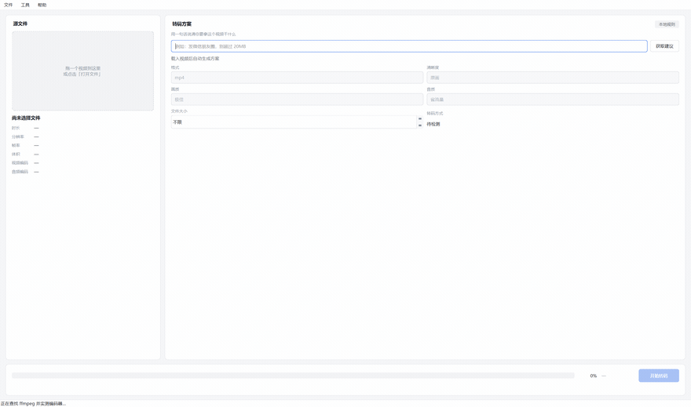
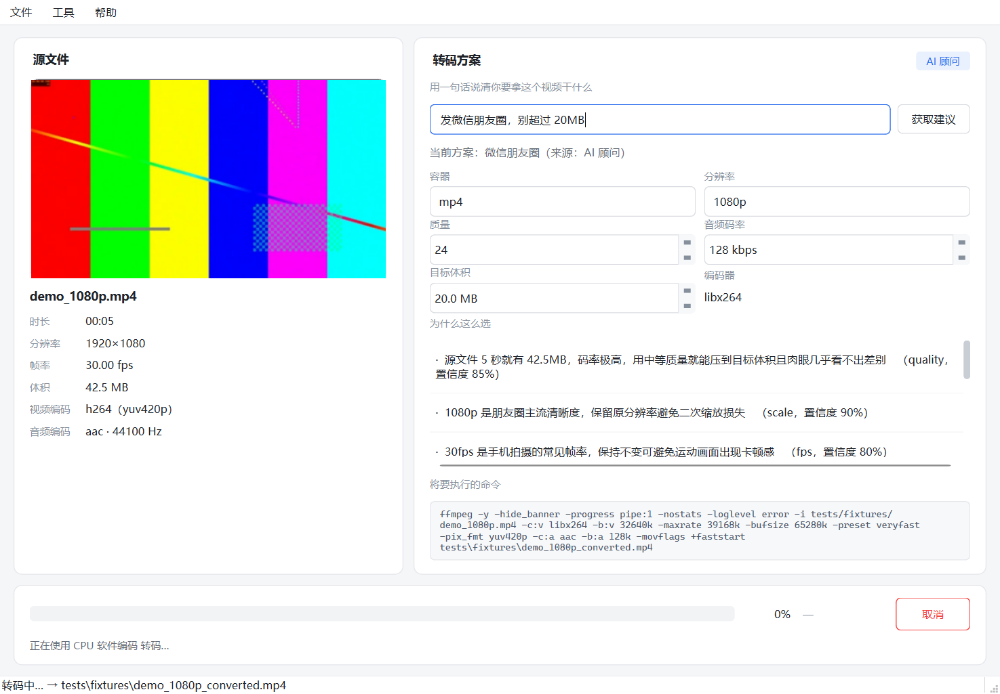
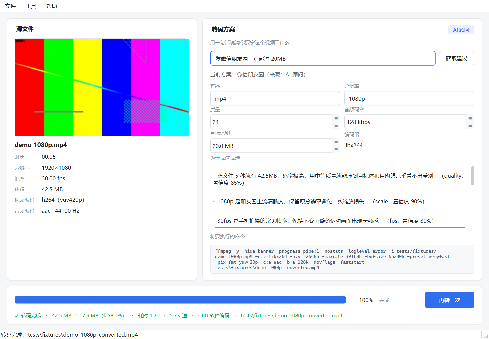

# VideoBox · AI 视频转码器

一个 Windows 桌面视频转码工具。用 PySide6（Qt for Python）做界面，用 FFmpeg 命令行做转码，
并内置一个「AI 参数顾问」——你用一句人话描述用途，它给出可校验、可编辑的转码参数。



> 上面这段 GIF 不是录屏，是 `scripts/make_demo_gif.py` 在应用进程内按帧抓窗口、再交给 ffmpeg 合成的，
> 所以每次跑都是同一套真流程：载入 → 探测 → 请求方案 → 转码 → 出结果。
> 原速只有 4 秒多，为了看得清才放慢到 13 秒。



> 笔试要求：用 AI 做一个视频格式转换器，限时三天。本仓库是提交物。
> 开发过程中的决策、踩坑与自我修正记录在 [`docs/SESSION_LOG.md`](docs/SESSION_LOG.md)。

---

## 一、先对答案：七条要求逐条对照

| # | 要求 | 实现 | 在哪 |
|---|---|---|---|
| 1 | 加载视频信息 + 显示缩略图 | ffprobe 解析全字段（分辨率/帧率/时长/编码/体积）显示在左栏；用 ffmpeg 输入 seek 抽帧作为大缩略图，带 sha256 缓存 | `core/probe.py` `core/thumb.py` |
| 2 | 用 ffmpeg 命令行转换 | 全部走子进程命令行，未接 libav API | `core/params.py` `infra/process.py` |
| 3 | 自行做一些优化 | 4 项，全部可量化（见下文「优化」） | — |
| 4 | 生成会话总结 md，记录决策与反馈 | [`docs/SESSION_LOG.md`](docs/SESSION_LOG.md)（开发过程）、[`docs/DECISIONS.md`](docs/DECISIONS.md)（技术选型取舍） | `docs/` |
| 5 | 提交 GitHub | 本仓库 | — |
| 6 | 界面选型须与"客户端"相关 | 原生 Qt Widgets 桌面程序，打包成独立 `.exe`，非网页套壳 | `videobox/ui/` |
| 7 | 目标是给人用，要测试 | 50 个单元测试 + 无人值守 E2E 脚本 + 干净环境双击验证 + [`docs/KNOWN_ISSUES.md`](docs/KNOWN_ISSUES.md) 主动交代短板 | `tests/` `scripts/` |

## 二、快速开始

### 方式 A：直接跑（推荐给只想看效果的人）

从 [Releases](../../releases) 下载 `VideoBox-win64.zip`，解压后双击 `VideoBox.exe`。
**不需要装 Python，也不需要装 FFmpeg**（已随包附带）。

### 方式 B：从源码跑

```bash
git clone <this-repo> && cd videobox
python -m venv .venv
.venv\Scripts\activate
pip install -r requirements.txt

# 准备 ffmpeg（仓库不放二进制，见 docs/SETUP.md）
# 生成测试素材
python scripts/make_fixtures.py

# 启动
python main.py
```

### 方式 C：自己打包

```bash
python scripts/build.py
```

## 三、它能做什么

**基础链路**：拖入视频 → 看到信息和缩略图 → 拿到参数方案 → 转码 → 看到前后对比。

**AI 参数顾问**（本项目的重点）

左边是普通转换器都有的参数表单，右边多了一个输入框，你可以说人话：

> 「发微信朋友圈，别超过 20MB」
> 「这是会议录屏，只要字看得清，画质无所谓」
> 「存档用，别给我降分辨率」

大模型会输出**结构化的参数**（不是一段散文），每一项都附带理由和置信度，
并且这些参数**可以直接在界面上改**，改完还能再问一次。

三条设计约束：
1. **模型不能输出命令串**，只能从枚举里选值，命令由程序拼装 —— 杜绝"提示词注入式"的危险参数
2. **提示词里注入本机实测可用的编码器**，模型不会推荐一台跑不动的硬件编码器
3. **无 API Key 时降级为本地规则引擎**，走同一套 schema、同一个界面，只是"大脑"换成关键词匹配。不是占位，是真能用的功能

## 四、优化（第 3 条要求）

四项都满足"用户能感知 + 能拿数字证明"：

| 优化 | 做法 | 效果 |
|---|---|---|
| **硬件编码器实测探测** | 不信 `ffmpeg -encoders` 的列表，真跑 1 秒试编码；失败时从日志里抠出人话原因 | 本机 RTX 5060 因驱动 573.24 < 610.00 被判定不可用，界面直接显示"显卡驱动版本过低"，而不是静默变慢 |
| **实时进度 + ETA + 可取消** | 解析 `-progress pipe:1`；取消时给 ffmpeg 写 `q`，让它正常收尾 | 取消后产物仍是可播放的完整视频，不是截断的坏文件 |
| **失败自动降级重试** | 硬件编码失败 → 自动切 `libx264` 重跑一次 | 用户不会因为显卡驱动问题看到一个红色报错 |
| **转码前后对比** | 体积、压缩率、耗时、实际码率写在结果行 | 42.5MB → 18.2MB（↓57%），耗时 1.3s |

另外有个不显眼但很实用的：**目标体积控制**。只给 `-b:v` 时 x264 在短视频上收敛不了
（实测目标 20MB 出了 38MB），加上 `-maxrate` / `-bufsize` 后才压到 18MB。细节见 SESSION_LOG。

转码完成后的界面（同一份文件，目标「发微信朋友圈，别超过 20MB」）：



## 五、架构

分层的唯一目的是**让核心逻辑能脱离界面被测试**。

```
videobox/
├── core/          零 Qt 依赖，纯函数，全部可单测
│   ├── models.py        VideoInfo / TranscodePlan / TranscodeResult
│   ├── probe.py         ffprobe JSON 解析 + ffmpeg -i 兜底
│   ├── thumb.py         抽帧与缓存
│   ├── params.py        plan → ffmpeg 参数列表
│   ├── progress.py      -progress 输出解析 + ETA
│   ├── plan_schema.py   LLM 输出清洗与校验
│   └── local_rules.py   无 Key 时的本地规则引擎
├── infra/         与外部世界打交道
│   ├── ffmpeg_bin.py    ffmpeg 定位降级链 + 编码器实测
│   ├── process.py       QProcess 封装（进度/取消/判定）
│   ├── llm_client.py    同步 LLM 客户端（标准库 urllib，零依赖）
│   ├── advisor.py       顾问编排：AI 与本地规则同一出口
│   └── logging_setup.py 日志落盘
└── ui/            PySide6
    ├── main_window.py   组装与状态机
    ├── tasks.py         线程池工人
    ├── style.qss        浅色主题
    └── widgets/         信息栏 / 顾问面板 / 进度面板
```

**线程模型**：转码用 `QProcess`（天生异步，走事件循环，不阻塞 UI）；
探测、抽帧、编码器实测这类同步子进程调用扔进 `QThreadPool`。
工作线程只允许产出 `QImage`，转 `QPixmap` 必须回主线程——跨线程碰 `QPixmap` 会直接崩。

## 六、测试

```bash
# 单元测试：50 个，纯函数，秒级完成
python -m unittest discover -s tests -t . -v

# 无界面冒烟：probe → params → QProcess 全链路真转码
python scripts/smoke_transcode.py tests/fixtures/sample_720p.mp4 "压小一点发朋友"

# 界面端到端（含自动截图）
python scripts/e2e_ui.py tests/fixtures/demo_1080p.mp4 "发微信朋友圈，别超过20MB"

# 录演示 GIF（进程内抓帧，不依赖录屏软件）
python scripts/make_demo_gif.py tests/fixtures/demo_1080p.mp4
```

单元测试覆盖的是**容易出隐性错误的地方**，不是凑数：
- `out_time_ms` 的单位其实是微秒（ffmpeg 的历史遗留），不做测试必然算错进度
- `ffmpeg -i` 输出里有 `0x31637661` 这种十六进制，正则稍不注意就会把分辨率解析成乱码
- 目标体积大于源文件时不能"压缩"，否则文件反而变大（这个 bug 真发生过）

## 七、文档

| 文档 | 内容 |
|---|---|
| [`docs/SESSION_LOG.md`](docs/SESSION_LOG.md) | **开发会话总结**：AI 在哪里帮上忙、在哪里出错、我怎么发现的 |
| [`docs/DECISIONS.md`](docs/DECISIONS.md) | 技术选型与范围取舍的理由 |
| [`docs/KNOWN_ISSUES.md`](docs/KNOWN_ISSUES.md) | 已知短板与后续规划（主动交代） |
| [`docs/SETUP.md`](docs/SETUP.md) | ffmpeg 获取与常见问题 |
| [`THIRD_PARTY_NOTICE.md`](THIRD_PARTY_NOTICE.md) | 第三方组件与许可证 |

## 八、环境

- Windows 10/11 x64
- Python 3.10+（开发用 3.13.9）
- PySide6 6.8+
- FFmpeg 7+（随包版本 9.0.1）
